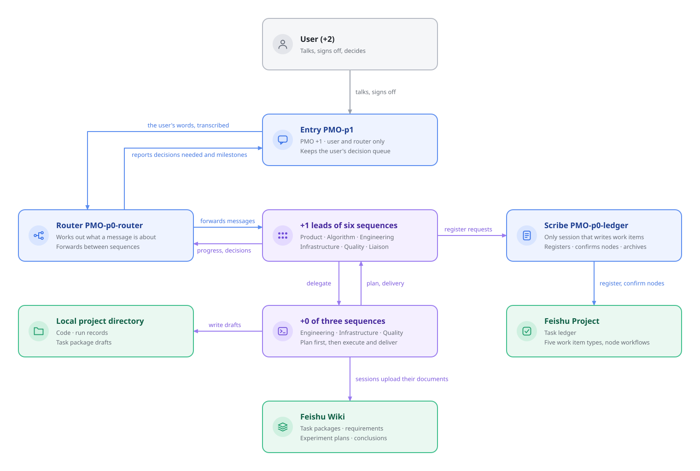

# Solo-Lab

[简体中文](README.md) | English

## Summary

Solo-Lab is a Claude plugin that lets a researcher hand a multi-week project over to Claude sessions, each with its own role.

The plugin itself runs in Chinese: role definitions, skills, script output and the Feishu template. This page explains it in English, but using the plugin requires reading Chinese.

When Claude is used directly, what a session is doing, how far it has got and what it has produced are all left for the user to remember. A session also loses part of what it knew when its context is compacted. Solo-Lab gives each session a fixed role, keeps the task ledger in Feishu Project and the task outputs in Feishu Docs. The three components the plugin depends on do the following:

| Component | What it handles | Without it |
| --- | --- | --- |
| Claude Desktop | Who does each kind of work: one session per role; sessions delegate, deliver and accept work under fixed rules | One agent session plays several roles in turn, each doing a different task, and their context blurs together |
| Feishu Project | How far a task has got: Feishu Project serves as the task ledger system and gives every task a work item. The step a task has reached, who is responsible and what is still missing are all recorded there | Task progress exists only in conversations. It is lost once a conversation grows long, and another session cannot pick it up |
| Feishu Wiki | What a task has produced so far: Feishu Docs holds the task packages (the files sessions hand over to each other), requirement documents, experiment plans and conclusions, and the documents live in the wiki | Task outputs are scattered across conversations, cannot be found and are not kept |

The user normally only needs to discuss tasks with the session that acts as the project entry, and that session passes the work on to the others. It is called the entry session below.

- In this plugin the entry session is called PMO-p1. Its definition is in the Architecture section below.

## Positioning

The plugin suits a user who runs a research project alone and is familiar with Claude Desktop and Feishu. The Feishu account must be able to sign in to Feishu Project and Feishu Wiki. Feishu Project is Feishu's project-management product (personal edition: 720 RMB per year).

It is a poor fit in these cases:

- **Several people share one project:** at present every session acts through the user's own Feishu Project account. A version that supports collaboration is planned.
- **No Feishu, or no personal access to Feishu Project/Meegle/Meego**
- **A small experiment that can be finished in an hour**
- **Users who have not downloaded Claude Desktop or cannot use it**

Pain points the project addresses

| User need | Problem with a conventional single session | How the plugin solves it |
| --- | --- | --- |
| **Different kinds of work run in parallel, and progress has to line up** | Once goal setting, background research, experiment design, coding, environment setup, evaluation and reporting are split across several sessions, each session knows only its own part. Nothing says who hands what to whom, so the user usually ends up relaying messages | Each kind of work has a fixed session. A delegation states the goal, the completion criteria one by one and the decisions that must not be changed. A user who wants to check something personally can open the responsible session and talk to it directly. |
| **When an agent says "done", there has to be evidence** | The agent replies "completed", and the user often still has to check again | Each completion criterion states in advance what counts as evidence, and this is recorded in Feishu Docs. On delivery the executing session goes through the criteria one by one and attaches the evidence, and the delegating side accepts the work. If something truly cannot be done, the session writes down what it tried, where it got stuck and what is missing. |
| **When an agent's approach goes off track, it has to show early** | Once work is handed over, the delegating side cannot see how it is being done, and learns only at delivery that the direction was wrong | For work that needs judgement on the way, the executing session first hands in a plan: how it intends to do the work, how it will split it and what resources it needs. It starts only after the delegating side confirms the plan. |
| **After a break of a few days, the agents have to pick up where they left off** | On coming back, the user has to read through the chat history to find out how far each thing has got, where it is stuck and what is waiting for an answer | Task progress is recorded on work items in the Feishu Project task ledger. Reasons for being blocked and the user's decisions are recorded in Feishu Docs and attached to the corresponding work item. |
| **What has been decided does not have to be decided again** | Earlier decisions live only in old conversations. A new decision may conflict with them, and a settled question may be asked again | The plugin can list the decisions the user has made and the conclusions already reached. When the user is asked for a new decision, the related earlier decisions are attached to the decision document together with their background at the time. |
| **Matters the user has to decide can all be handled through a dedicated entry point** | A conventional session stops by itself when it meets a decision about the approach, so the project moves only when the user is free. If it asks nothing, Claude may set the direction on its own | The plugin keeps decision work items in Feishu Project as the user's decision list. While tasks advance in parallel, the user only has to attend to the scheduling of external resources and three internal questions: what the research task is, what counts as the goal being met, and where to go once the conclusion is out |

## Architecture

Once the plugin is installed, task materials are kept in the following four places

| Component | Content |
| --- | --- |
| Claude Desktop | A section named after the Feishu Project space appears in the sidebar: 12 sessions by default, each taking one role |
| Local directory | Task-related files (code, task package drafts, third-party libraries and so on) |
| Feishu Project | The task ledger, with five types of work item: research task, same-sequence request, cross-sequence request, decision and feedback.<br>Once opened, each type of work item follows its node workflow |
| Feishu Wiki | Task documents. It keeps the task packages of every stage |

An overview of how Claude Desktop, Feishu Project and Feishu Wiki interact



The user talks only to the entry. The entry transcribes the user's words and hands them to the router. The router checks the task ledger to work out which piece of work the words belong to and who should get them, and passes them on unchanged. Progress from the sequences goes back to the router first, and the router hands the entry only the matters the user has to decide and the milestones.

Key terms

| Term | Meaning |
| --- | --- |
| Sequence | The seven lines the work is divided into. What each one covers is in the table below |
| Level | Every sequence has one +1 that leads: it sets goals and acceptance criteria, confirms plans and accepts the work. Three sequences, engineering, infrastructure and quality, also have +0 sessions that do the work, because their work involves hands-on development. The work of product, algorithm and liaison is one continuous line of thought, so by default they have only a +1. The user plays +2 |
| Task package | A file that sessions use to hand work over. There are three kinds: request packages, delivery packages and decision packages |
| Plan | What a +0 hands to its +1 for confirmation before it starts work that needs judgement on the way: a description of how it will do the work |
| Closed task | Work whose method can be stated in advance and that needs no new judgement halfway. The +1 writes the method into the request and assigns it to a +0 directly, with no plan required |
| Task ledger | All the work items in Feishu Project. It is the reference for how far each piece of work has got, who is responsible and what has been changed |

Responsibilities of the seven sequences

| Sequence | Responsibility | Sessions opened by default |
| --- | --- | --- |
| Product | Task goals and success criteria, requirement documents | +1 |
| Algorithm | Designs the task context, the target conditions and target thresholds for a task to succeed, and the experiment plan | +1 |
| Engineering | Writes the experiment code for the plan the algorithm sequence proposes, runs the experiments and reports the results | +1 and one +0 |
| Infrastructure | Maintains the experiment platform and monitors the available resources | +1 and one +0 |
| Quality | Designs the evaluation protocol, maintains the eval set and carries out the evaluation | +1 and one +0 |
| PMO | Covers three duties: entry point for user interaction, task routing and task scribe.<br>These are, in turn: talking to the user and maintaining the user's decision queue (the entry, +1); deciding which work item a task belongs to and passing messages between the sequences (the router, +0); maintaining the task ledger (the scribe, +0) | Entry, router, scribe |
| Liaison | Maintains the written material for the advisor or collaborators | +1 |

## Installation

### Steps

1. First prepare the following software

| Software | Tested version | Responsibility |
| --- | --- | --- |
| Claude Desktop | 6.28899.6 | The user interface; maintains the task sessions |
| Claude | 2.1.257 | The command line used to install the plugin |
| Lark-cli & Feishu | 1.0.98 | Reads and writes Feishu Docs and Feishu Wiki |
| Meegle-cli & Feishu Project/Meegle/Meego | 1.0.27 | Reads and writes Feishu Project |
| Python | 3.12.13 | Runs the plugin. `python3.12` has to be on the PATH: the plugin's hooks and script commands use that name, not `python3` |

Download links:

- meegle-cli: https://github.com/larksuite/meegle-cli
- lark-cli: https://github.com/larksuite/cli

The Feishu Project space does not have to be built by hand: initialisation creates it from the template that comes with the plugin. The template is described in [Feishu Project template](docs/飞书项目模板/README.md), in Chinese.

2. Install the plugin:

```bash
claude plugin marketplace add https://github.com/Touricks/Solo-Lab.git
claude plugin install solo-lab@solo-lab
```

3. In Claude Desktop, select an empty directory as the task initialisation directory, open a new session, choose the fable model and the auto permission mode, and write:

```text
用 solo-lab 初始化这个目录
```

The phrase means "initialise this directory with solo-lab".

- It is best to add the project name and a one-line description. The project name is also the name of the Feishu Project space and the Feishu Wiki, and the prefix of the session titles.
- This session is called the initialisation session. When a command-line login has expired, it shows a QR code for the user to scan. It does everything else itself and hands over to the user at the end.
- Once the project files are written, the initialisation session stops and asks the user to trust the directory: choose Trust workspace in the app and send one message, and it goes on. With hooks and permission rules now in the directory, the app starts sessions that other sessions open there only after the user has trusted it.
- The default pool opens in one round and needs no further message. Only a pool made larger in the task file is opened in two rounds: the app lets a session open at most 10 further sessions after each message from the user, so the initialisation session then stops partway and waits for the user to send one more message before it goes on:

```text
继续开池
```

The phrase means "go on opening the pool".

### Checklist

After initialisation the user should be able to see:

- A newly created Feishu Project space, named after the project by default.
- A research task named after the project already exists in the Feishu Project space, stopped at the first step.
- A Feishu knowledge space (wiki) with the same name
- 12 new sessions in Claude Desktop, in the project session that holds the initialisation session.
- A new `.env` in the local project directory, recording the links to Feishu Project and Feishu Wiki.

## Usage

The user normally only needs to talk to the project entry session. Its name in the sidebar is `[<project name>] PMO-p1`.

After initialisation, the first thing the user does is discuss with the entry session to set up the first research task. The entry session interviews the user, then fills in and renames the research task that was generated during initialisation. If the user would rather look for a project direction first, the user tells the entry session “先探索下项目方向” ("explore the project direction first") to open a separate task, and terminates the research task generated during initialisation in the Feishu Project GUI.

### Steps of a research task

Each research task answers one question. A research task that has a criterion and has to reach a conclusion follows the formal-experiment flow, nine steps from opening to archive. The agents advance most of the steps on their own. The user decides at three points: stating the question to research when the task is opened, and one sign-off each at step 4 and step 9.

| Step | Task | Sequence responsible | Supporting sequence | The user's part |
| --- | --- | --- | --- | --- |
| 1 | Set the goal | Product |  |  |
| 2 | Preliminary research | Algorithm |  |  |
| 3 | Fix the requirements and the eval set | Product | Quality: builds and freezes the eval set, writes the evaluation protocol |  |
| 4 | Hypothesis review | Algorithm | Quality: checks the thresholds | **Sign-off**: freeze the conditions for success and the target thresholds; compute is spent only after this |
| 5 | Design the experiment plan | Algorithm |  |  |
| 6 | Build the experiment platform | Infrastructure |  |  |
| 7 | Run the offline evaluation | Engineering | Quality: produces the official score |  |
| 8 | Draw the conclusion | Algorithm |  |  |
| 9 | Decide the next step | PMO |  | **Sign-off**: decide the next piece of work based on the current experiment conclusion |
| Archive | Documents move to the archive node | PMO (scribe) |  |  |

Each step is advanced by the +1 of the sequence responsible. The conclusion is one of three: holds, does not hold, cannot be determined.

A research task that has no hypothesis yet and only looks for a direction follows the exploration flow, four steps: set the direction, explore, propose a hypothesis, archive. All four are handled by the +1 that opened the task. What the task produces is a hypothesis worth testing, that is, the question for a research task.

### How work is divided within a step

Take step 7, the engineering sequence running the offline evaluation:

1. The engineering +1 writes a request package that fixes only the goal, the acceptance criteria and the scope of authority, and delegates it to the engineering +0.
2. The engineering +0 hands in a plan first. Once the +1 confirms it, the +0 works to the plan and hands in a delivery package when done.
3. The engineering +1 checks the delivery against the acceptance criteria one by one. If it does not pass, the work goes back to be redone, with the reason written down.
4. The official score has to come from the quality sequence. The engineering +1 sends the quality +1 a cross-sequence request package, and the quality sequence completes and delivers it in the same way.
5. Once the evaluation has run and the run ID is filled in, the engineering +1 asks the scribe to confirm step 7, and the research task moves to step 8.

A request that a +1 delegates to a +0 session of the same sequence and a cross-sequence request are each one work item in Feishu Project; a closed task has no work item. Every package is one document in Feishu Wiki. Product, algorithm and liaison have only a +1 by default, and in these three sequences the +1 does the work itself.

### A few tips

- **Mention the work item ID when speaking,** so the router does not have to guess which research task the sentence belongs to.
- **Give sign-offs and decisions in the entry session.** The project entry session consults the queue of decision work items in Feishu Project and passes the user whatever is waiting for a decision. A decision package is given as a link to a Feishu document, and the user can annotate the document directly.
- **To discuss an approach with the +1 of a sequence, go straight into its session.** The user can ask it to write the outcome up as a decision package and pass it to the PMO sequence.
- **To find out what was decided before, ask the entry session.** It looks up the decisions the user has made and the conclusions already reached, and answers from the original text.
- **To see task progress, go to Feishu Project.** Feishu Project serves as the task ledger.
- **Going back to an earlier step is the user's decision.** If the user finds that a step was not carried out to standard, the task can be rolled back. Which step to go back to, and why, is written by the +1 session of the sequence whose task is being rolled back, as a decision package for approval. Once the user approves it, the scribe session rolls the node back in Feishu Project.
- **Keep the initialisation session and do not archive it.** Signing in again, checking the deployment and upgrading the plugin are all done in it. It handles operations and maintenance for the whole plugin system

The full guide is [docs/使用说明.md](docs/使用说明.md), in Chinese.

## Design

**One desktop session per role**

- Problem: when one conversation plays several roles in turn, their context blurs together. A subtask handed to a temporary worker disappears once it is done; the user cannot see the process and cannot change the approach midway.
- Our approach: each role is a session that stays open in the sidebar. The user can open any of them, see what it is doing and give it instructions directly. Delegations and deliveries are messages between sessions and stay in each session's history.

**A +1 that leads and +0 sessions that do the work: work that needs judgement starts with a plan**

- Problem: if the +1 fixes the method before handing work to a +0, the +0 can only stop and ask when it meets something unexpected. If the +0 sets the method itself, the +1 learns only at delivery whether the work was done right.
- Our approach: for work that needs judgement on the way, the +1 fixes only the goal, the acceptance criteria and the scope of authority. The +0 hands in a plan first and starts only after the +1 confirms it, and adjustments within the plan are the +0's to make. For a closed task whose method can be stated, the +1 writes the method down and assigns it directly, with no plan and no work item in Feishu Project. When it is unclear whether a task is closed: if the method cannot be written down concretely and still leaves choices open, the work is handled as a request that starts with a plan; and if a closed task is asked to change course a second time halfway, the +0 stops and reports to the session that assigned it, which turns it into a request that starts with a plan or takes the work back. By default only engineering, infrastructure and quality have +0 sessions; in product, algorithm and liaison the +1 does the work itself.

**Only the scribe writes work items**

- Problem: if a dozen project sessions could all change the task ledger, it would end up in a mess sooner or later, and nobody could tell who wrote what when something went wrong.
- Our approach: creating work items and moving work item instances through their nodes are done by one session only, the scribe, through one script. A Feishu document is uploaded and revised by the session that wrote it, and the script only checks that it is the author; to create a work item or advance a node, a session must send the scribe a registration request. A hook in the project blocks the other sessions' write commands to Feishu Project.

**Feishu Project is the reference for task progress**

- Problem: if task progress is recorded only in agent sessions, a different session cannot pick it up.
- Our approach: in Feishu Project, one task package corresponds to one work item. The step the work item has reached is the step the work has reached. What each step requires before it can move on is the set of required fields on the task node, so an agent knows what is still missing before it advances a task. The task flows and their forms live in the Feishu Project template. The plugin carries only a contract that names the types, fields and roles the scripts have to handle according to their meaning.

**Deciding whether a task succeeded**

- Problem: the conventional approach is to have one agent review another agent's conclusion, but the reviewing agent has no new evidence in hand and can only judge from the text.
- Our approach: the eval set and the thresholds are fixed before any result exists, and are frozen after the user signs off once the task reaches step 4. The official score is produced only by the quality sequence on the frozen eval set. What the side running the experiments scores for itself is a development score, used only for debugging. Every run is recorded in the task ledger.

**The user only makes decisions**

- Problem: the user's attention is very valuable. If everything waits for the user's confirmation, the project can move only when the user is free.
- Our approach: the user has to be present when a work item reaches three nodes: setting the task goal, reviewing the task's acceptance criteria, and deciding the direction after acceptance. Other questions that come up during a task are registered by the scribe session in the queue of decision work items in Feishu Project, and the user can decide them all in one go when free. When a new decision is made, the plugin pulls out the related earlier decisions and conclusions and attaches them to the decision package, so the user does not have to recall them.

## Upgrading

After the plugin is updated, ask the initialisation session to run `init --apply` again, then quit and reopen Claude Desktop. Some versions also need changes to the task file or the Feishu space. What each version needs is in the “升级和检查” section of [docs/使用说明.md](docs/使用说明.md); what each version changed is in [CHANGELOG.md](CHANGELOG.md). Both are in Chinese.

Going from 1.0.x to 1.1.0 touches the task file, the Feishu space and the sessions, six steps in all. Do not let the sessions go on working until the steps are done.

## More documents

The documents below are in Chinese.

| Document | Content |
| --- | --- |
| [User guide](docs/使用说明.md) | The full guide: every step of initialisation, the five types of work item, the decision queue, the session pool, upgrading and common questions |
| [Changelog](CHANGELOG.md) | What each version changed |
| [Feishu Project template](docs/飞书项目模板/README.md) | The template's structure, build manual and changelog |

## Limitations

- **Permission mode:** the initialisation session must use auto mode. The sessions in the pool all use the same class of permission mode; do not switch one of them to bypass on its own. Messages between a bypass session and sessions in other modes are held in both directions, the desktop app cannot show the approval prompt, and the messages are dropped after 5 minutes by default. If a command is blocked by the permission check, the user has to go to that session's window and run the command there, or run it in a terminal.
- **A deleted Feishu Wiki or Project space cannot be restored:** if the project space or the knowledge space is deleted midway, recovery is not supported

## Version

v1.1.4
