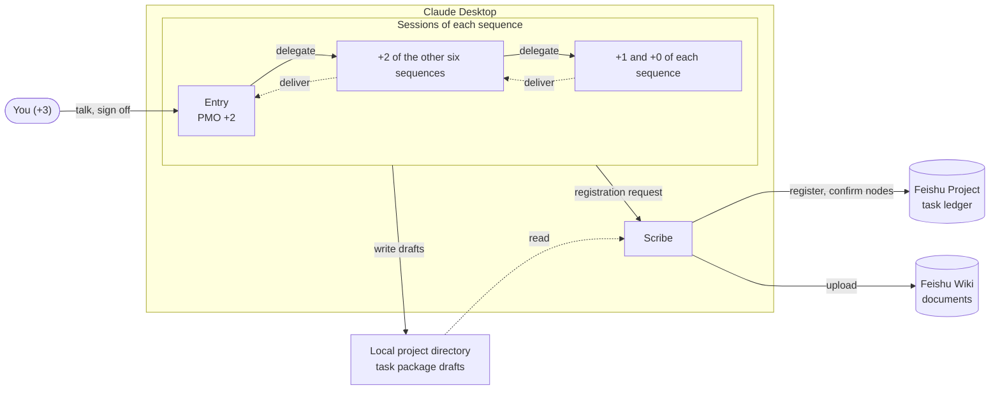

# Solo-Lab

[简体中文](README.md) | English

## Summary

Solo-Lab is a Claude plugin that lets a researcher hand a multi-week project over to Claude sessions, each with its own role.

The plugin itself runs in Chinese: role definitions, skills, script output and the Feishu template. This page explains it in English, but using the plugin requires reading Chinese.

When Claude is used directly, what a session is doing, how far it has got and what it has produced are all left for the user to remember. A session also loses part of what it knew when its context is compacted. The Solo-Lab plugin gives each session a sequence and a level as its identity, and uses them to manage the type and direction of its tasks. It keeps the task ledger in Feishu Project and the task outputs in Feishu Docs. The functions of the three main components the plugin depends on are summarised below.

| Component | What it handles | Without it |
| --- | --- | --- |
| Claude Desktop | Who does each kind of work: one session per role; sessions delegate, deliver and accept work under fixed rules | One agent session plays several roles in turn, each doing a different task, and their context blurs together |
| Feishu Project | How far a task has got: Feishu Project serves as the task ledger system and gives every task a work item. The step a task has reached, who is responsible and what is still missing are all recorded there | Task progress exists only in conversations. It is lost once a conversation grows long, and another session cannot pick it up |
| Feishu Wiki | What a task has produced so far: Feishu Docs holds the task packages (the files sessions hand over to each other), requirement documents, experiment plans and conclusions, and the documents live in the wiki | Task outputs are scattered across conversations, cannot be found and are not kept |

The user normally only needs to discuss tasks with the session that acts as the project entry, and that session delegates the work to the others. It is called the entry session below.

- In this plugin the entry session is called PMO-p2. Its definition is in the Architecture section below.

## Positioning

The plugin suits a user who runs a research project alone and is familiar with Claude Desktop and Feishu. The Feishu account must be able to sign in to Feishu Project and Feishu Wiki. Feishu Project is Feishu's project-management product (personal edition: 720 RMB per year).

It is a poor fit in these cases:

- **Several people share one project:** at present every session acts through the user's own Feishu Project account. A version that supports collaboration is planned.
- **No Feishu, or no personal access to Feishu Project/Meegle/Meego**
- **A small experiment that can be finished in an hour**
- **Users who have not downloaded Claude Desktop or cannot use it**

Pain points the project addresses

| User need | Problem with a conventional single session | How the plugin solves it |
| --- | --- | --- |
| **Different kinds of work run in parallel, and progress has to line up** | Once goal setting, background research, experiment design, coding, environment setup, evaluation and reporting are split across several sessions, each session knows only its own part. Nothing says who hands what to whom, so the user usually ends up relaying messages | Each kind of work has a fixed session. A delegation states the goal, the completion criteria one by one and the decisions that must not be changed. A user who wants to check something personally can open the responsible session and talk to it directly. |
| **When an agent says "done", there has to be evidence** | The agent replies "completed", and the user often still has to check again | Each completion criterion states in advance what counts as evidence, and this is recorded in Feishu Docs. On delivery the executing session goes through the criteria one by one and attaches the evidence, and the delegating side accepts the work. If something truly cannot be done, the session writes down what it tried, where it got stuck and what is missing. |
| **After a break of a few days, the agents have to pick up where they left off** | On coming back, the user has to read through the chat history to find out how far each thing has got, where it is stuck and what is waiting for an answer | Task progress is recorded on work items in the Feishu Project task ledger. Reasons for being blocked and the user's decisions are recorded in Feishu Docs and attached to the corresponding work item. |
| **Matters the user has to decide can all be handled through a dedicated entry point** | A conventional session stops by itself when it meets a decision about the approach, so the project moves only when the user is free. If it asks nothing, Claude may set the direction on its own | The plugin keeps decision work items in Feishu Project as the user's decision list. While tasks advance in parallel, the user only has to attend to the scheduling of external resources and three internal questions: what the research task is, what counts as the goal being met, and where to go once the conclusion is out |

## Architecture

Once the plugin is installed, task-related documents are kept in four places

| Component | Content |
| --- | --- |
| Claude Desktop | A section named after the Feishu Project space appears in the sidebar: 19 sessions by default, each taking one role |
| Local directory | Task-related files (code, task package drafts, third-party libraries and so on) |
| Feishu Project | The task ledger, with five types of work item: research task, same-sequence request, cross-sequence request, decision and feedback.<br>Once opened, each type of work item follows its node workflow |
| Feishu Wiki | Task documents. It keeps the task packages of every stage |

An overview of how Claude Desktop, Feishu Project and Feishu Wiki interact



Key terms

| Term | Meaning |
| --- | --- |
| Sequence | The seven lines the work is divided into. What each one covers is in the table below |
| Level | Each sequence has three levels: +2 sets goals and acceptance criteria, +1 decides the method, breaks work down and accepts it, +0 executes with the method it is given. The user plays +3 |
| Task package | A file that sessions use to hand work over. There are three kinds: request packages, delivery packages and decision packages |
| Task ledger | All the work items in Feishu Project. It is the reference for how far each piece of work has got, who is responsible and what has been changed |

Responsibilities of the seven sequences

| Sequence | Responsibility |
| --- | --- |
| Product | Task goals and success criteria, requirement documents |
| Algorithm | Designs the task context, the target conditions and target thresholds for a task to succeed, and the experiment plan |
| Engineering | Writes the experiment code for the plan the algorithm sequence proposes, runs the experiments and reports the results |
| Infrastructure | Maintains the experiment platform and monitors the available resources |
| Quality | Designs the evaluation protocol, maintains the eval set and carries out the evaluation |
| PMO | Covers three duties: entry point for user interaction, task routing and task scribe.<br>These are, in turn: talking to the user, dispatching tasks and maintaining the user's decision queue (+2); deciding which work item a task belongs to (+1); maintaining the task ledger and the task documents (+0) |
| Liaison | Maintains the written material for the advisor or collaborators |

## Installation

### Steps

1. First prepare the following software

| Software | Tested version | Responsibility |
| --- | --- | --- |
| Claude Desktop | 5.11492.0 | The user interface; maintains the task sessions |
| Claude | 2.1.219 |  |
| Lark-cli & Feishu | 1.0.98 | Reads and writes Feishu Docs and Feishu Wiki |
| Meegle-cli & Feishu Project/Meegle/Meego | 1.0.27 | Reads and writes Feishu Project |
| Python | 3.9.6 | Runs the plugin |

Download links:

- meegle-cli: https://github.com/larksuite/meegle-cli
- lark-cli: https://github.com/larksuite/cli

2. Install the plugin:

```bash
claude plugin marketplace add https://github.com/Touricks/Solo-Lab.git
claude plugin install solo-lab@solo-lab
```

3. In Claude Desktop, select an empty directory as the task initialisation directory, open a new session, choose the auto permission mode, and write:

```text
用 solo-lab 初始化这个目录
```

The phrase means "initialise this directory with solo-lab".

- The app lets a session open at most 10 further sessions after each message from the user, so the pool has to be opened in two rounds. Partway through its work, the initialisation session stops and waits for the user to send one more message, so that it can go on building the initial session pool:

```text
继续开池
```

The phrase means "go on opening the pool".

### Checklist

After initialisation the user should be able to see:

- A newly created Feishu Project space, named after the project by default.
- A research task named after the project already exists in the Feishu Project space, stopped at the first step.
- A Feishu knowledge space (wiki) with the same name
- 19 new sessions in Claude Desktop, in the project session that holds the initialisation session.
- A new `.env` in the local project directory, recording the links to Feishu Project and Feishu Wiki.

## Usage

The user normally only needs to talk to the project entry session. Its name in the sidebar is `[<project name>] PMO-p2-01`. Every task has 9 steps from opening to archive. The agents can advance some of them on their own, but three steps need a decision from the user, which gives the user more control over what the agents do. The steps are outlined below

After initialisation, the first thing the user does is discuss with the entry session to set up the first research task. The entry session interviews the user, then fills in and renames the research task that was generated during initialisation. If the user would rather look for a project direction first, the user tells the entry session “先探索下项目方向” ("explore the project direction first") to open a separate task, and terminates the research task generated during initialisation in the Feishu Project GUI.

| Step | Task | Sequence of the agent responsible | The user's part |
| --- | --- | --- | --- |
| 0 | The user opens a research task | PMO | **Sign-off:** state the question to research |
| 1 | Set the task goal | Product |  |
| 2 | Prepare the task context | Algorithm |  |
| 3 | Prepare the PRD and the Eval Set | Product, Quality |  |
| 4 | Set the conditions for the task to succeed | Algorithm, Quality | **Sign-off**: freeze the conditions for success and the target thresholds |
| 5 | Design the experiment plan | Algorithm |  |
| 6 | Build the experiment platform | Infrastructure |  |
| 7 | Run the Eval Set | Engineering, Quality |  |
| 8 | Draw the conclusion | Algorithm |  |
| 9 | Discuss the next step | PMO | **Sign-off**: decide the next piece of work based on the current experiment conclusion |
| Archive | Documents move to the archive node | PMO (scribe) |  |

A few tips:

- **Mention the work item ID when speaking,** so the router does not have to guess which research task the sentence belongs to.
- **Give sign-offs and decisions in the entry session.** The project entry session consults the queue of decision work items in Feishu Project and passes the user whatever is waiting for a decision.
- **To discuss an approach with a +2, go straight into its session.** The user can ask it to write the outcome up as a decision package and pass it to the PMO sequence.
- **To see task progress, go to Feishu Project.** Feishu Project serves as the task ledger.
- **Going back to an earlier step is the user's decision.** If the user finds that a step was not carried out to standard, the task can be rolled back. Which step to go back to, and why, is written by the +2 session of the task being rolled back, as a decision package for approval. Once the user approves it, the scribe session rolls the node back in Feishu Project.
- **Keep the initialisation session and do not archive it.** Signing in again, checking the deployment and upgrading the plugin are all done in it. It handles operations and maintenance for the whole plugin system

## Design

**One desktop session per role**

- Problem: when one conversation plays several roles in turn, their context blurs together. A subtask handed to a temporary worker disappears once it is done; the user cannot see the process and cannot change the approach midway.
- Our approach: each role is a session that stays open in the sidebar. The user can open any of them, see what it is doing and give it instructions directly. Delegations and deliveries are messages between sessions and stay in each session's history.

**Only the scribe writes to Feishu**

- Problem: if a dozen project sessions could all change the task ledger, it would end up in a mess sooner or later, and nobody could tell who wrote what when something went wrong.
- Our approach: work items, fields, nodes and documents are written by one session only, the scribe, through one script. The other sessions write drafts locally and send the scribe a registration request. A hook in the project blocks write commands from the other sessions.

**Feishu Project is the reference for task progress**

- Problem: if task progress is recorded only in agent sessions, a different session cannot pick it up.
- Our approach: in Feishu Project, one task package corresponds to one work item. The step the work item has reached is the step the work has reached. What each step requires before it can move on is the set of required fields on the task node, so an agent knows what is still missing before it advances a task. The task flows and their forms live in the Feishu Project template. The plugin carries only a contract that names the types, fields and roles the scripts have to handle according to their meaning.

**Deciding whether a task succeeded**

- Problem: the conventional approach is to have one agent review another agent's conclusion, but the reviewing agent has no new evidence in hand and can only judge from the text.
- Our approach: the eval set and the thresholds are fixed before any result exists, and are frozen after the user signs off once the task reaches step 4. The official score is produced only by the quality sequence on the frozen eval set. What the executing side runs for itself is a development score, used only for debugging. Every run is recorded in the task ledger.

**The user only makes decisions**

- Problem: the user's attention is very valuable. If everything waits for the user's confirmation, the project can move only when the user is free.
- Our approach: the user has to be present only for project initialisation and for the two sign-off steps of a task. Other questions that come up during a task are registered by the scribe session in the queue of decision work items in Feishu Project, and the user can decide them all in one go when free.

## Limitations

- **Permission mode:** the initialisation session must use auto mode
- **A deleted Feishu Wiki or Project space cannot be restored:** if the project space or the knowledge space is deleted midway, recovery is not supported

## Version

v1.0.1
