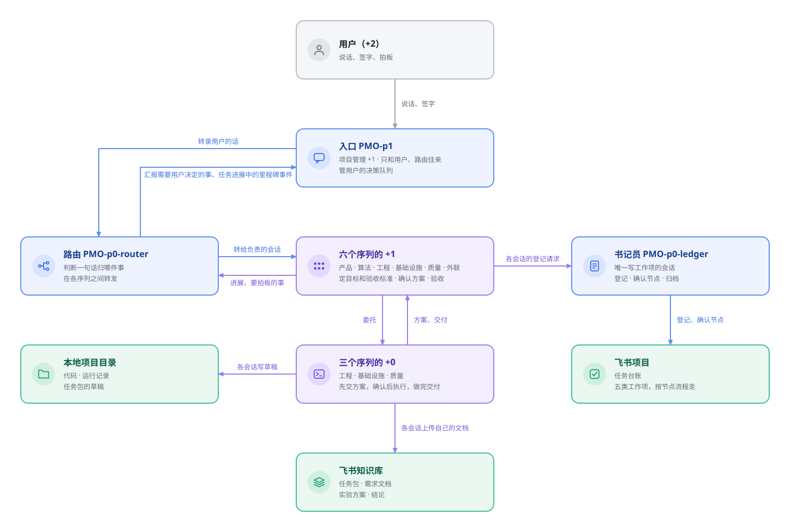

# Solo-Lab

简体中文 | [English](README.en.md)

## 项目摘要

Solo-Lab 是一个 Claude 插件，让研究者把一个要做几周的项目交给各有分工的 Claude 会话去做。

直接用 Claude 时，一个会话在做什么、做到哪了、做出了什么，都靠用户记着。会话信息本身会随上下文压缩部分丢失。Solo-Lab 给每个会话一个固定的角色，用飞书项目维护任务台账，用飞书文档保存任务产出。下面是插件依赖的三个组件各自的功能：

| 组件 | 管什么 | 没有它会怎样 |
| --- | --- | --- |
| Claude Desktop | 每种工作由谁来做：每个角色一个会话，按固定的规则委托、交付、验收 | 一个 Agent 会话轮流扮演多个执行不同任务的角色，上下文混在一起 |
| 飞书项目 | 任务做到哪了：飞书项目作为任务台账系统，为每个任务分配一条工作项。任务走到哪一步、谁负责、还缺什么都登记在上面 | 任务进度只在对话里，对话一长就丢，换个会话接不上 |
| 飞书知识库 | 任务当前做出了什么：飞书文档保存任务包（会话之间交接用的文件）、需求文档、实验方案、结论，文档放在知识库里 | 任务产出散在各个对话里，查不到，也留不下来 |

用户平时只需和承担项目入口职责的会话讨论任务内容，由它把事情转给其他会话，下文叫它入口会话。

- 入口会话在本插件系统中称 PMO-p1，定义详情见下方“插件架构”一节

## 项目定位

该插件适合独自开展一个研究项目、熟悉 Claude Desktop 和飞书系统的用户。飞书账号需要能登录飞书项目和飞书知识库。飞书项目是飞书的项目管理产品（个人版 720RMB/年）。

下面几种情况不适合用它：

- **多人共用一个项目：** 当前所有会话用的都是用户自己的飞书项目账号，未来计划推出支持多人协作的插件版本
- **不用飞书，或没有飞书项目/Meegle/Meego 的个人访问权限**
- **一个小时能做完的小实验**
- **未下载或无法使用 Claude Desktop 的用户**

该项目解决的痛点

| 用户需求 | 传统单会话的问题 | 本插件的解决方法 |
| --- | --- | --- |
| **不同工作并行做，进度要对得上** | 定目标、查资料、设计实验、写代码、搭环境、评测、写汇报分给几个会话以后，每个会话只知道自己那一块，谁该把什么交给谁没有约定，多半还是用户在中间传话 | 每种工作有固定的会话，委托时写明目标、逐条的完成标准和不能改的决定。用户想亲自把关某件事，可以点开负责的会话直接谈。 |
| **Agent 说“做完了”需要有凭据** | Agent 回一句“已完成”，用户往往还得自己再查一遍 | 每条完成标准事先写明拿什么当证据，登记到云文档。执行的会话交付时逐条对照、附上证据，由委托方验收。确实做不到的，写清试了什么、卡在哪、缺什么。 |
| **Agent 的做法跑偏了要早知道** | 活交出去以后，中途怎么做的委托方看不到，等到交付才知道方向不对 | 需要中途做判断的活，执行的会话先交一份方案，写明打算怎么做、怎么拆、要多少资源。委托方确认以后才动手。 |
| **工作停几天回来 Agent 要接得上** | 用户回来的时候要翻会话聊天记录，才知道每件事做到哪了、卡在哪、哪些在等答复 | 任务进展登记在飞书项目任务台账的工作项上，卡住的原因、用户拍板的事登记在飞书云文档并挂在对应工作项实例上。 |
| **定过的事不用再定一遍** | 以前定过什么只留在旧对话里。新的决定可能和它冲突，定过的事也可能被再问一遍 | 插件可以列出用户定过的决定和已经得出的结论。请用户做新决定时，有关的旧决定连同当时的背景一起附在决策文档里。 |
| **需要由用户决定的事情可以由用户通过特定入口统一处理** | 传统会话遇到方案决策问题时会自动停下，项目只能按用户的空闲时间推进。什么都不问，方向又可能被 Claude 自己定了 | 插件在飞书项目中维护决策工作项作为给用户的决策清单。在并行推进的任务中，用户只需要关注外部资源调度和内部以下三个方面的问题：研究任务是什么，任务目标怎样算成立，结论出来以后往哪走 |

## 插件架构

插件装好以后，任务材料存放在以下四个地方

| 组件 | 内容 |
| --- | --- |
| Claude Desktop | 侧栏里出现一个以飞书项目空间为命名的分区：默认 12 个会话，每个会话承担一个角色 |
| 本地目录 | 任务相关文件（含代码，任务包草稿，第三方库等） |
| 飞书项目 | 任务台账，包含五类工作项：研究任务、同序列需求、跨序列需求、决策、反馈。<br>每类工作项立项后按工作项节点工作流执行 |
| 飞书知识库 | 任务文档。保存各阶段任务包 |

Claude Desktop、飞书项目和飞书知识库的交互方式概览



用户只和入口说话。入口把用户的话转录下来交给路由，路由对着任务台账判断这句话归哪件事、该给谁，原样转过去。各序列的进展先回到路由，路由只把要用户定的事和里程碑交给入口。

关键词概念解释

| 概念 | 说明 |
| --- | --- |
| 序列 | 按分工划出的七条线，各管什么见下面的表 |
| 职级 | 每个序列有一个带队的 +1：定目标和验收标准、确认方案、验收。工程、基础设施、质量三个序列另有干活的 +0，这三个序列的活要动手开发；产品、算法、外联的活是一条连续的思考，默认只有 +1。用户扮演 +2 |
| 任务包 | 会话之间交接用的文件，有三种：需求包、交付包、决策包 |
| 方案 | +0 接到需要中途做判断的活，动手前交给 +1 确认的做法说明 |
| 封闭任务 | 做法说得清、做到一半不需要新判断的活。+1 把方法一起写明，直接派给 +0，不用先交方案 |
| 任务台账 | 飞书项目里的全部工作项。每件事走到哪一步、谁负责、改过什么，以它为准 |

七个序列的职责

| 序列 | 职责 | 默认开的会话 |
| --- | --- | --- |
| 产品 | 任务目标和成功标准，需求文档 | +1 |
| 算法 | 设计任务上下文、任务成功的目标条件和目标阈值、实验方案 | +1 |
| 工程 | 为算法提出的实验方案编写实验代码，运行实验，反馈结果 | +1，一个 +0 |
| 基础设施 | 维护实验平台，监控可用资源 | +1，一个 +0 |
| 质量 | 设计评测协议，维护评测集，执行评测流程 | +1，一个 +0 |
| 项目管理 | 承担用户交互入口、任务路由、任务书记员三个职责。<br>分别负责与用户交互并维护用户决策队列（入口，+1），判断任务的工作项归属、在各序列之间转发（路由，+0），维护任务台账（书记员，+0） | 入口、路由、书记员 |
| 外联 | 维护给导师或合作人的书面材料 | +1 |

## 插件安装

### 安装步骤

1. 首先准备以下软件

| 软件 | 测试版本 | 职责 |
| --- | --- | --- |
| Claude Desktop | 5.11492.0 | 用户交互界面，维护任务会话 |
| Claude | 2.1.219 | 安装插件用的命令行 |
| Lark-cli & 飞书 | 1.0.98 | 读写飞书文档和知识库 |
| Meegle-cli & 飞书项目/Meegle/Meego | 1.0.27 | 读写飞书项目 |
| Python | 3.12.13 | 运行插件。命令行里要有 `python3.12`，插件的 hook 和脚本命令都用这个名字，不用 `python3` |

下载地址：

- meegle-cli：https://github.com/larksuite/meegle-cli
- lark-cli：https://github.com/larksuite/cli

飞书项目的空间不用自己搭，初始化时照插件带的模板创建，模板的说明见 [feishu-template/README.md](feishu-template/README.md)。

2. 安装插件：

```bash
claude plugin marketplace add https://github.com/Touricks/Solo-Lab.git
claude plugin install solo-lab@solo-lab
```

3. 在 Claude Desktop 里选中一个空目录作为任务初始化目录，新开一个会话，模型选 fable，权限模式选 auto，然后写：

```text
用 solo-lab 初始化这个目录
```

- 最好顺带说项目名和一句话描述。项目名也是飞书项目空间、飞书知识库的名字和会话标题的前缀。
- 这个会话叫初始化会话。命令行登录失效时它给出二维码，请用户扫码；其余的事它自己做完，最后向用户交接。
- 默认的会话池一轮开完，不用再回话。任务文件把会话池开大了才要分两轮：应用限制用户每发一条消息以后，会话自己最多再开出 10 个会话，这时初始化会话会停下来，等用户回一句话再接着开：

```text
继续开池
```

### 自检清单

初始化完成后，用户应能看到这些内容：

- 一个创建完毕的飞书项目空间，名字默认等于项目名。
- 飞书项目空间里已有一条以项目名命名的研究任务，停在第一步。
- 一个同名的飞书知识空间（知识库）
- Claude Desktop 中指定初始化会话所在的项目 Session 出现 12 个新建会话。
- 项目本地目录里新增 `.env`，记录飞书项目和飞书知识库链接。

## 插件用法

用户平时只需要和项目入口会话讨论，它在侧栏名称为 `[<项目名>] PMO-p1`。

初始化完成后，用户的第一件事是和入口会话进行讨论去立项第一个研究任务。入口会话会访谈用户，把初始化时生成的那条研究任务补全并改名。如果用户希望先找项目方向，对入口会话说“先探索下项目方向”另开一条任务，将初始化生成的那条研究任务到飞书项目 GUI 上终止。

### 研究任务的步骤

每条研究任务回答一个问题。有判据、要下结论的研究任务走正式实验流程，从立项到归档共九步。多数步骤由 Agent 自己推进，用户在三个地方做决定：开任务时说清要研究的问题，第 4 步和第 9 步各签一次字。

| 步骤 | 任务 | 负责的序列 | 配合的序列 | 用户职责 |
| --- | --- | --- | --- | --- |
| 1 | 确定目标 | 产品 |  |  |
| 2 | 前期调研 | 算法 |  |  |
| 3 | 定需求和评测集 | 产品 | 质量：建并冻结评测集，写评测协议 |  |
| 4 | 假设评审 | 算法 | 质量：核对阈值 | **签字**：冻结任务成功的条件和目标阈值，签了才开始花算力 |
| 5 | 设计实验方案 | 算法 |  |  |
| 6 | 搭建实验平台 | 基础设施 |  |  |
| 7 | 执行离线评测 | 工程 | 质量：出正式分数 |  |
| 8 | 得出结论 | 算法 |  |  |
| 9 | 决定下一步 | 项目管理 |  | **签字**：根据当前实验结论决定下一步工作 |
| 归档 | 文档移到归档节点 | 项目管理-书记员 |  |  |

每一步由负责序列的 +1 推进。结论三选一：成立、不成立、无法判定。

还没有假设、只想找方向的研究任务走探索流程，共四步：定方向、探索、提出假设、归档，都由开这条任务的 +1 负责。该任务的产出是值得验证的假设，即研究任务的问题。

### 一个步骤里怎么分工

以第 7 步“工程序列执行离线评测”为例：

1. 工程 +1 写需求包，只定目标、验收标准和授权范围，委托给工程 +0。
2. 工程 +0 先交方案。+1 确认以后，+0 照方案做，做完交交付包。
3. 工程 +1 逐条对照验收标准验收。不通过就退回去重做，并写明原因。
4. 正式分数要质量序列来出。工程 +1 给质量 +1 发一份跨序列的需求包，质量序列照同样的办法做完交付。
5. 评测跑完、运行 ID 填上以后，工程 +1 请书记员确认第 7 步，研究任务走到第 8 步。

同序列+1向+0会话下发的需求和跨序列的需求，在飞书项目里各是一条工作项；封闭任务不建工作项。每一份包在飞书知识库里是一篇文档。产品、算法、外联默认只有 +1，这三个序列的活由 +1 自己做。

### 几个技巧

- **说话时带上工作项 ID，** 路由就不用猜这句话属于哪个研究任务。
- **签字和拍板都在入口会话里回答。** 项目入口会话参考飞书项目决策工作项队列，将待用户决定的事交给用户。决策包给的是飞书文档的链接，用户可以直接在文档上批注。
- **想和某个序列的 +1 讨论方案，直接进入会话。** 会话结论可以让它写成决策包交给项目管理序列。
- **想知道以前定过什么，问入口会话。** 它查出用户定过的决定和已有的结论，照原文回答。
- **看任务进度进入飞书项目。** 飞书项目承担任务台账功能。
- **退回某一步由用户决定。** 如果用户发现任务执行中的某步骤不达标，可以回退。退到哪一步、为什么，由回退任务对应序列的 +1 会话写一份待批准的决策包，用户批准后书记员会话在飞书项目中执行回滚节点。
- **初始化会话留着别归档。** 重新登录、检查部署、升级插件都在它里面做；它承担着整个插件系统的运维工作

完整的用法见[使用说明](docs/使用说明.md)。

## 设计思路

**每个角色一个桌面会话**

- 问题：一个对话里轮流扮演多个角色，上下文会混在一起。临时派出去的子任务做完就散，用户看不到过程，也没法中途改变执行思路。
- 我们的做法：每个角色是侧栏里一个长期开着的会话。用户能点开任何一个，看它在做什么，直接交代。委托和交付是会话之间的消息，留在各自的记录里。

**带队的 +1 和干活的 +0：要判断的活先交方案**

- 问题：+1 把做法定死再交给 +0，+0 遇到没料到的情况只能停下来问。让 +0 自己定做法，+1 又要等到交付才知道做得对不对。
- 我们的做法：需要中途做判断的活，+1 只定目标、验收标准和授权范围，+0 先交方案，+1 确认后才执行，范围内的调整 +0 自己定。做法说得清的封闭任务，+1 把方法写明直接派，不用交方案，也不在飞书项目里建工作项。+0 默认只配给工程、基础设施、质量三个序列；产品、算法、外联的活默认由 +1 自己做。

**工作项只有书记员写**

- 问题：如果十几个项目会话都能改任务台账，迟早写乱，出了错也查不清是谁写的。
- 我们的做法：工作项新建和工作项实例的节点流转只由书记员一个会话写，走同一个脚本。飞书文档由写它的会话自己上传、修订，脚本只核对它是不是作者；要建工作项、推进节点，必须给书记员发登记请求。项目里的 hook 会拦住其他会话对飞书项目的写命令。

**任务进度以飞书项目为准**

- 问题：如果任务进度只记在 Agent 会话里，换一个会话就接不上。
- 我们的做法：在飞书项目中，一份任务包对应一条工作项。工作项走到哪一步，这件事就做到哪一步。每一步骤的流转要求是任务节点上的必填字段，任务推进之前 Agent 知道这一步还缺什么。任务流程和流转表单放在飞书项目的模板里；插件只带一份约定，写明脚本要按含义处理的类型、字段和角色。

**任务成功的判定**

- 问题：传统方案是让一个 agent 审另一个 agent 的结论，但审的 agent 手里没有新的证据，只能对着文字判断。
- 我们的做法：评测集和阈值在出结果之前定下，任务步骤到达第 4 步后由用户签字后冻结。正式分数只由质量序列在冻结的评测集上跑出，实验方自己跑的是开发分，只用来调试。所有运行都记进任务台账。

**用户只做决定**

- 问题：用户的注意力非常宝贵。每件事都等用户确认，项目就只能按用户的空闲时间走。
- 我们的做法：用户在工作项到达确定任务目标，任务验收标准审阅和验收后的任务方向节点时必须到场。任务中遇到的其他问题由书记员会话登记到飞书项目决策工作项队列，用户可以在空闲时一起做决定。做新决定时，以前定过的有关决定和结论由插件摘出来附在决策包里，用户不用自己回忆。

## 升级

插件更新以后，请初始化会话重跑一次 `init --apply`，再退出并重开 Claude Desktop。有的版本还要改任务文件或飞书空间。每一版要做什么，写在[使用说明](docs/使用说明.md)的“升级和检查”一节；每一版改了什么，见[更新记录](CHANGELOG.md)。

从 1.0.x 升到 1.1.0 要动任务文件、飞书空间和会话，共六步。做完以前不要让会话接着干活。

## 更多文档

| 文档 | 内容 |
| --- | --- |
| [使用说明](docs/使用说明.md) | 完整的用法：初始化的每一步、五类工作项、决策队列、会话池、升级、常见问题 |
| [更新记录](CHANGELOG.md) | 每一版改了什么 |
| [飞书项目模板](feishu-template/README.md) | 模板的结构、搭建手册和更新记录 |
| [开发说明](docs/开发说明.md) | 插件的目录结构、测试和发布 |

## 当前限制

- **权限模式：** 初始化会话必须用 auto 模式。会话池里的会话用同一类权限模式，不要把其中一个单独切到 bypass。切成 bypass 的会话和其他模式的会话之间，消息会被双向扣下，桌面端弹不出审批框，默认 5 分钟后丢弃。若命令被权限检查拦下，用户需要到那个会话的窗口里执行对应命令，或者自己在终端里运行。
- **飞书知识库/项目空间删除无法恢复：** 项目空间或知识空间中途被删，不支持恢复

## 插件版本

v1.1.0
