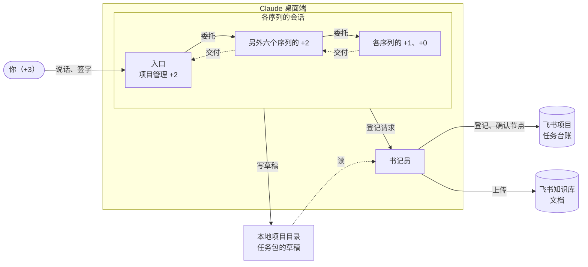

# Solo-Lab

简体中文 | [English](README.en.md)

## 项目摘要

Solo-Lab 是一个 Claude 插件，让研究者把一个要做几周的项目交给各有分工的 Claude 会话去做。

直接用 Claude 时，一个会话在做什么、做到哪了、做出了什么，都靠用户记着。会话信息本身会随上下文压缩部分丢失。Solo-Lab 插件通过为不同会话设计序列和职级身份管理其任务类型和方向，通过飞书项目维护任务账本，通过飞书文档维护任务产出。下面是插件依赖的三个重要组件的功能概述

| 组件 | 管什么 | 没有它会怎样 |
| --- | --- | --- |
| Claude Desktop | 每种工作由谁来做：每个角色一个会话，按固定的规则委托、交付、验收 | 一个 Agent 会话轮流扮演多个执行不同任务的角色，上下文混在一起 |
| 飞书项目 | 任务做到哪了：飞书项目作为任务台账系统，为每个任务分配一条工作项。任务走到哪一步、谁负责、还缺什么都登记在上面 | 任务进度只在对话里，对话一长就丢，换个会话接不上 |
| 飞书知识库 | 任务当前做出了什么：飞书文档保存任务包（会话之间交接用的文件）、需求文档、实验方案、结论，文档放在知识库里 | 任务产出散在各个对话里，查不到，也留不下来 |

用户平时只需和承担项目入口职责的会话讨论任务内容，由它把事情委托给其他会话，下文叫它入口会话

- 入口会话在本插件系统中称PMO-p2，定义详情见下方“插件架构”一节

## 项目定位

该插件适合独自开展一个研究项目、熟悉 Claude Desktop和飞书系统的用户。飞书账号需要能登录飞书项目和飞书知识库。飞书项目是飞书的项目管理产品（个人版720RMB/年）。

下面几种情况不适合用它：

- **多人共用一个项目：** 当前所有会话用的都是用户自己的飞书项目账号，未来计划推出支持多人协作的插件版本
- **不用飞书，或没有飞书项目/Meegle/Meego的个人访问权限**
- **一个小时能做完的小实验**
- **未下载或无法使用Claude Desktop的用户**

该项目解决的痛点

| 用户需求 | 传统单会话的问题 | 本插件的解决方法 |
| --- | --- | --- |
| **不同工作并行做，进度要对得上** | 定目标、查资料、设计实验、写代码、搭环境、评测、写汇报分给几个会话以后，每个会话只知道自己那一块，谁该把什么交给谁没有约定，多半还是用户在中间传话 | 每种工作有固定的会话，委托时写明目标、逐条的完成标准和不能改的决定。用户想亲自把关某件事，可以点开负责的会话直接谈。 |
| **Agent说“做完了”需要有凭据** | Agent 回一句“已完成”，用户往往还得自己再查一遍 | 每条完成标准事先写明拿什么当证据，登记到云文档。执行的会话交付时逐条对照、附上证据，由委托方验收。确实做不到的，写清试了什么、卡在哪、缺什么。 |
| **工作停几天回来Agent要接得上** | 用户回来的时候要翻会话聊天记录，才知道每件事做到哪了、卡在哪、哪些在等答复 | 任务进展登记在飞书项目任务账本的工作项上，卡住的原因、用户拍板的事登记在飞书云文档并挂在对应工作项实例上。 |
| **需要由用户决定的事情可以由用户通过特定入口统一处理** | 传统会话遇到方案决策问题时会自动停下，项目只能按用户的空闲时间推进。什么都不问，方向又可能被 Claude 自己定了 | 插件在飞书项目中维护决策工作项作为给用户的决策清单。在并行推进的任务中，用户只需要关注外部资源调度和内部以下三个方面的问题：研究任务是什么，任务目标怎样算成立，结论出来以后往哪走 |

## 插件架构

插件装好以后，任务相关文档放在四个地方

| 组件 | 内容 |
| --- | --- |
| Claude Desktop | 侧栏里出现一个以飞书项目空间为命名的分区：默认 15 个会话，每个会话承担一个角色 |
| 本地目录 | 任务相关文件（含代码，任务包草稿，第三方库等） |
| 飞书项目 | 任务台账，包含五类工作项：研究任务、同序列需求、跨序列需求、决策、反馈。<br>每类工作项立项后按工作项节点工作流执行 |
| 飞书知识库 | 任务文档。保存各阶段任务包 |

Claude Desktop, 飞书项目和飞书知识库的交互方式概览



关键词概念解释

| 概念 | 说明 |
| --- | --- |
| 序列 | 按分工划出的七条线，各管什么见下面的表 |
| 职级 | 每个序列分三级：+2 定目标和验收标准，+1 定方法、拆任务、验收，+0 照给定的方法执行。用户扮演 +3 |
| 任务包 | 会话之间交接用的文件，有三种：需求包、交付包、决策包 |
| 任务台账 | 飞书项目里的全部工作项。每件事走到哪一步、谁负责、改过什么，以它为准 |

七个序列的职责

| 序列 | 职责 |
| --- | --- |
| 产品 | 任务目标和成功标准，需求文档 |
| 算法 | 设计任务上下文、任务成功的目标条件和目标阈值、实验方案 |
| 工程 | 为算法提出的实验方案编写实验代码，运行实验，反馈结果 |
| 基础设施 | 维护实验平台，监控可用资源 |
| 质量 | 设计评测协议，维护评测集，执行评测流程 |
| 项目管理 | 承担用户交互入口、任务路由、任务书记员三个职责。<br>分别负责与用户交互，分发任务并维护用户决策队列（+2），判断任务的工作项归属（+1），维护任务台账与任务文档（+0） |
| 外联 | 维护给导师或合作人的书面材料 |

## 插件安装

### 安装步骤

1. 首先准备以下软件

| 软件 | 测试版本 | 职责 |
| --- | --- | --- |
| Claude Desktop | 5.11492.0 | 用户交互界面，维护任务会话 |
| Claude | 2.1.219 |  |
| Lark-cli & 飞书 | 1.0.98 | 读写飞书文档和知识库 |
| Meegle-cli & 飞书项目/Meegle/Meego | 1.0.27 | 读写飞书项目 |
| Python | 3.12.13 | 运行插件。命令行里要有 `python3.12`，插件的 hook 和脚本命令都用这个名字，不用 `python3` |

下载地址：

- meegle-cli：https://github.com/larksuite/meegle-cli
- lark-cli：https://github.com/larksuite/cli

2. 安装插件：

```bash
claude plugin marketplace add https://github.com/Touricks/Solo-Lab.git
claude plugin install solo-lab@solo-lab
```

3. 在 Claude Desktop里选中一个空目录作为任务初始化目录，新开一个会话，权限模式选 auto，然后写：

```text
用 solo-lab 初始化这个目录
```

- 默认的会话池一轮开完，不用再回话。任务文件把会话池开大了才要分两轮：应用限制用户每发一条消息以后，会话自己最多再开出 10 个会话，这时初始化会话会停下来，等用户回一句话再接着开：

```text
继续开池
```

### 自检清单

初始化完成后，用户应能看到这些内容：

- 一个创建完毕的飞书项目空间，名字默认等于项目名。
- 飞书项目空间里已有一条以项目名命名的研究任务，停在第一步。
- 一个同名的飞书知识空间（知识库）
- Claude Desktop 中指定初始化会话所在的项目Session出现 15 个新建会话。
- 项目本地目录里新增 `.env`，记录飞书项目和飞书知识库链接。

## 插件用法

用户平时只需要和项目入口会话讨论，它在侧栏名称为 `[<项目名>] PMO-p2-01`。每个任务从立项到归档，拥有9个步骤，其中一些步骤可以由Agent自动推进，但是有三个步骤需要用户做决策以提升用户对Agent工作内容的掌控程度。各步骤概述见下

初始化完成后，用户的第一件事是和入口会话进行讨论去立项第一个研究任务。入口会话会访谈用户，把初始化时生成的那条研究任务补全并改名。如果用户希望先找项目方向，对入口会话说“先探索下项目方向”另开一条任务，将初始化生成的那条研究任务到飞书项目GUI上终止。

| 步骤 | 任务 | 负责该步骤的Agent所在序列 | 用户职责 |
| --- | --- | --- | --- |
| 0 | 用户开启一条研究任务 | 项目管理 | **签字：** 说清要研究的问题 |
| 1 | 确定任务目标 | 产品 |  |
| 2 | 准备任务上下文 | 算法 |  |
| 3 | 定需求和评测集 | 产品，质量 |  |
| 4 | 确定任务成功的条件 | 算法，质量 | **签字**：冻结任务成功的条件和目标阈值 |
| 5 | 设计实验方案 | 算法 |  |
| 6 | 搭建实验平台 | 基础设施 |  |
| 7 | 执行离线评测 | 工程，质量 |  |
| 8 | 得出结论 | 算法 |  |
| 9 | 决定下一步 | 项目管理 | **签字**：根据当前实验结论决定下一步工作 |
| 归档 | 文档移到归档节点 | 项目管理-书记员 |  |

几个技巧：

- **说话时带上工作项ID，** 路由就不用猜这句话属于哪个研究任务。
- **签字和拍板都在入口会话里回答。** 项目入口会话参考飞书项目决策工作项队列，将待用户决定的事交给用户。
- **想和某个 +2讨论方案，直接进入会话。** 会话结论可以让它写成决策包交给项目管理序列。
- **看任务进度进入飞书项目。** 飞书项目承担任务台账功能。
- **退回某一步由用户决定。** 如果用户发现任务执行中的某步骤不达标，可以回退。退到哪一步、为什么，由回退任务对应职级为+2的会话写一份带批准决策包，用户批准后书记员会话在飞书项目中执行回滚节点。
- **初始化会话留着别归档。** 重新登录、检查部署、升级插件都在它里面做；它承担着整个插件系统的运维工作

## 设计思路

**每个角色一个桌面会话**

- 问题：一个对话里轮流扮演多个角色，上下文会混在一起。临时派出去的子任务做完就散，用户看不到过程，也没法中途改变执行思路。
- 我们的做法：每个角色是侧栏里一个长期开着的会话。用户能点开任何一个，看它在做什么，直接交代。委托和交付是会话之间的消息，留在各自的记录里。

**只有书记员写飞书**

- 问题：如果十几个项目会话都能改任务台账，迟早写乱，出了错也查不清是谁写的。
- 我们的做法：工作项、字段、节点和文档只由书记员一个会话写，走同一个脚本。别的会话把草稿写在本地，给书记员发登记请求。项目里的 hook 拦住其他会话的写命令。

**任务进度以飞书项目为准**

- 问题：如果任务进度只记在Agent会话里，换一个会话就接不上。
- 我们的做法：在飞书项目中，一份任务包对应一条工作项。工作项走到哪一步，这件事就做到哪一步。每一步骤的流转要求是任务节点上的必填字段，任务推进之前Agent知道这一步还缺什么。任务流程和流转表单放在飞书项目的模板里；插件只带一份约定，写明脚本要按含义处理的类型、字段和角色。

**任务成功的判定**

- 问题：传统方案是让一个 agent 审另一个 agent 的结论，但审的agent手里没有新的证据，只能对着文字判断。
- 我们的做法：评测集和阈值在出结果之前定下，任务步骤到达第 4 步后由用户签字后冻结。正式分数只由质量序列在冻结的评测集上跑出，实验方自己跑的是开发分，只用来调试。所有运行都记进任务台账。

**用户只做决定**

- 问题：用户的注意力非常宝贵。每件事都等用户确认，项目就只能按用户的空闲时间走。
- 我们的做法：用户只在项目初始化和任务的两个步骤签字时必须到场。任务中遇到的其他问题由书记员会话登记到飞书项目决策工作项队列，用户可以在空闲时一起做决定。

## 当前限制

- **权限模式：** 初始化会话必须用 auto 模式
- **飞书知识库/项目空间删除无法恢复：** 项目空间或知识空间中途被删，不支持恢复

## 插件版本

v1.0.12
